

  

  

  
  
  
  


I'm Adhya, a Computer Science student, developer, designer, and someone who has a habit of turning random ideas into actual projects.

I like being somewhere between engineering and creativity. One day I'm figuring out how something works under the hood; the next, I'm obsessing over a few pixels that don't feel quite right.

I build, experiment, break stuff, fix it (eventually), and learn something new along the way.

I don't wait for permission to build. If an idea interests me, I'd rather try making it real and figure things out as I go.

**Currently exploring:**

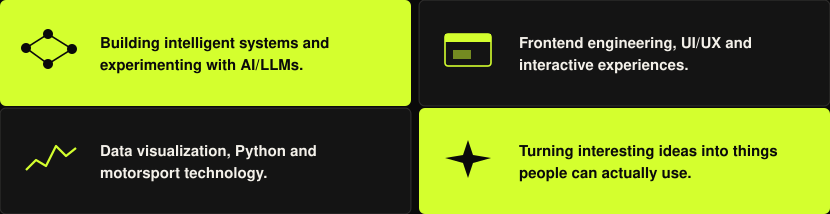

<i>Still figuring things out. Still building.</i>


<table>
  <tr>
    <td width="33%"><a href="https://github.com/geekadhya/f1-telemetry-analyzer"></a></td>
    <td width="33%"><a href="https://github.com/geekadhya/mimi">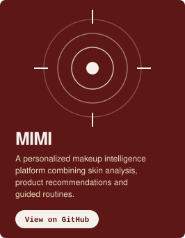</a></td>
    <td width="33%"><a href="https://github.com/geekadhya/adhya-portfolio">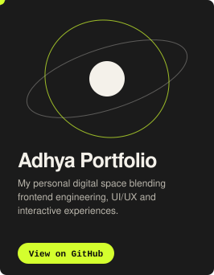</a></td>
  </tr>
</table>


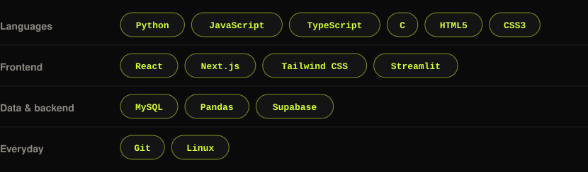


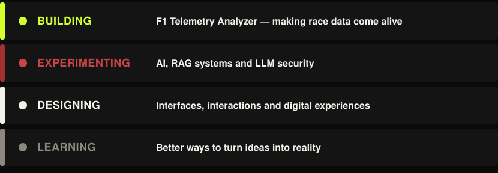


I'm interested in the things that happen when technology meets the real world: visual effects, film, motorsport, design, interactive experiences and the occasional rabbit hole I didn't plan on falling into.

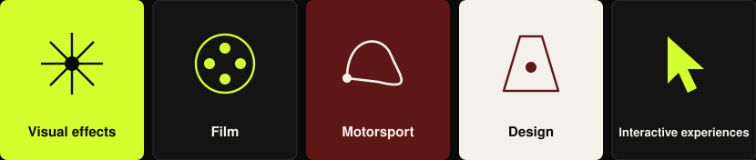

I enjoy collaborating, exchanging ideas and learning from people who approach problems differently.

If you're building something interesting, I'd love to hear about it.

  <b>Build something. Break something. Learn something. Repeat.</b>

  

