  

  

  
  
  
  

---

## 01 A little about me

I'm Adhya, a Computer Science student, developer, designer, and someone who has a habit of turning random ideas into actual projects.

I like being somewhere between engineering and creativity. One day I'm figuring out how something works under the hood; the next, I'm obsessing over a few pixels that don't feel quite right.

I build, experiment, break stuff, fix it (eventually), and learn something new along the way.

I don't wait for permission to build. If an idea interests me, I'd rather try making it real and figure things out as I go.

**Currently exploring:** 
- Building intelligent systems and experimenting with AI/LLMs.
- Frontend engineering, UI/UX and interactive experiences.
- Data visualization, Python and motorsport technology.
- Turning interesting ideas into things people can actually use.

Still figuring things out. Still building.

---

## 02 Featured projects

| Project | What it is |
| :--- | :--- |
| 🏎️ **[F1 Telemetry Analyzer](https://github.com/geekadhya/f1-telemetry-analyzer)** | A motorsport-inspired telemetry dashboard exploring race performance and driver data. |
| 💄 **[MIMI](https://github.com/geekadhya/mimi)** | A personalized makeup intelligence platform combining skin analysis, product recommendations and guided routines. |
| 🌌 **[Adhya Portfolio](https://github.com/geekadhya/adhya-portfolio)** | My personal digital space blending frontend engineering, UI/UX and interactive experiences. |

---

## 03 My toolbox

  
  
  
  
  
  
  
  
  
  
  
  
  
  
  

---

## 04 Currently in the workshop

  
  
  

| | What's happening |
| :--- | :--- |
| 🏎️ **Building** | F1 Telemetry Analyzer — making race data come alive |
| 🛡️ **Experimenting** | AI, RAG systems and LLM security |
| 🎨 **Designing** | Interfaces, interactions and digital experiences |
| 🧠 **Learning** | Better ways to turn ideas into reality |

  <i>"Still figuring things out. Still building."</i>

---

## 05 Beyond the code

I'm interested in the things that happen when technology meets the real world visual effects, film, motorsport, design, interactive experiences and the occasional rabbit hole I didn't plan on falling into.

I enjoy collaborating, exchanging ideas and learning from people who approach problems differently.

If you're building something interesting, I'd love to hear about it.

  <b>Build something. Break something. Learn something. Repeat.</b>

  

